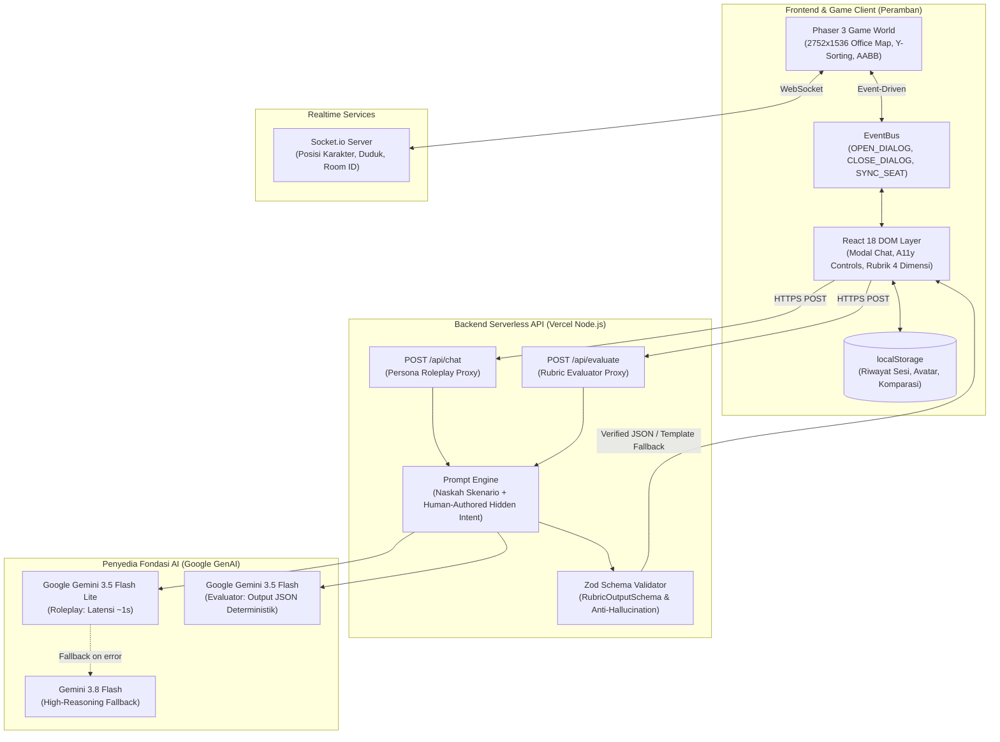

# 🧠 NEUROSIM: Simulator Dinamika Kantor Berbasis Agen AI untuk Profesional Neurodivergen

> **Mengubah Tantangan Sosial Menjadi Kesiapan Profesional Melalui Simulasi Ruang Kerja Berbasis AI yang Aman, Adaptif, dan Terukur.**

[](https://github.com/papatripat/neurosim)
[](https://github.com/papatripat/neurosim)
[](https://neurosim-demo.vercel.app)
[](https://github.com/papatripat/neurosim)
[](https://github.com/papatripat/neurosim)

Disusun oleh Tim **"mamah doain aku lolos final"** — Universitas Pembangunan Nasional "Veteran" Jawa Timur:
- **Rifat Abhista** — *Lead Backend & AI Architecture*
- **Priyoga Listyo Ananda** — *2D Game World & Phaser Engine*
- **Baginda Putra Krista** — *Frontend UI/UX, Aksesibilitas & Konten Skenario*

🌐 **Akses Demo Langsung (Production):** [https://neurosim-demo.vercel.app](https://neurosim-demo.vercel.app)

---

## 📌 Daftar Isi
1. [Latar Belakang & Urgensi Masalah](#-latar-belakang--urgensi-masalah)
2. [Solusi Kami: NEUROSIM](#-solusi-kami-neurosim)
3. [Fitur-Fitur Utama Produk](#-fitur-fitur-utama-produk)
4. [Tiga Skenario Inti & Peta Kantor 5 Zona](#-tiga-skenario-inti--peta-kantor-5-zona)
5. [Rubrik Evaluasi 4 Dimensi Objektif](#-rubrik-evaluasi-4-dimensi-objektif)
6. [Arsitektur Sistem & Rekayasa AI](#-arsitektur-sistem--rekayasa-ai)
7. [Keselamatan Psikologis & Aksesibilitas Sensorik](#-keselamatan-psikologis--aksesibilitas-sensorik)
8. [Tabel Teknologi & Dependensi](#-tabel-teknologi--dependensi)
9. [Panduan Instalasi & Menjalankan Proyek](#-panduan-instalasi--menjalankan-proyek)
10. [Deklarasi Penggunaan AI & Pihak Ketiga (AI Use & Third-Party Declaration)](#-deklarasi-penggunaan-ai--pihak-ketiga-ai-use--third-party-declaration)
11. [Lisensi & Referensi Ilmiah](#-lisensi--referensi-ilmiah)

---

## 🧩 Latar Belakang & Urgensi Masalah

Mahasiswa tingkat akhir dan lulusan baru (*fresh graduate*) neurodivergen—seperti individu pada spektrum autisme, ADHD, maupun gaya kognitif neuro-minoritas lainnya—sering kali memiliki kompetensi teknis yang luar biasa tinggi. Namun, banyak dari mereka mengalami hambatan besar pada **"kurikulum tersembunyi" (*hidden curriculum*)** di dunia kerja: mengurai komunikasi implisit sehari-hari di lingkungan kantor.

Tantangan nyata di tempat kerja meliputi:
- **Instruksi Atasan yang Samar:** *"Tolong dirapikan ya, besok pagi sudah harus bisa dilihat"* (tanpa rincian bagian mana yang dimaksud atau jam berapa tenggat pastinya).
- **Kritik yang Dibungkus Basa-Basi:** *"Menarik sih konsepnya, tapi mungkin bisa dipikirkan lagi"* (tanpa penjelasan bagian mana yang bermasalah).
- **Perubahan Mendadak di Luar Jam Kerja:** Klien mendesak perombakan sistem di malam hari menjelang presentasi direksi.

Situasi-situasi ini kerap memicu kebingungan, kecemasan akut (*social burnout*), dan fenomena *masking* (memaksa berpura-pura menjadi neurotipikal demi diterima) yang menguras energi mental.

### Landasan Teori & Payung Regulasi
- **Teori *Double Empathy Problem*** (Milton, 2012): Kesulitan komunikasi antara neurodivergen dan neurotipikal bukanlah defisit sepihak, melainkan perbedaan cara memahami konteks dan mengekspresikan maksud. **NEUROSIM tidak bertujuan "memperbaiki" atau menyeragamkan pengguna agar terdengar neurotipikal**. Sebaliknya, NEUROSIM memfasilitasi pengguna untuk berlatih mengklarifikasi maksud, membaca konteks tersirat, dan menyampaikan batasan kerja secara tegas dan profesional dengan gaya komunikasi autentik mereka sendiri.
- **Payung Hukum Indonesia:** Sejalan dengan amanat **UU No. 8 Tahun 2016 Pasal 53** (kuota ketenagakerjaan inklusif) dan **Peraturan Pemerintah No. 60 Tahun 2020** tentang Unit Layanan Disabilitas Bidang Ketenagakerjaan.

---

## 💡 Solusi Kami: NEUROSIM

**NEUROSIM** adalah platform simulasi komunikasi kerja berbasis web yang memadukan eksplorasi kantor virtual 2D interaktif (*Gather-like environment*) dengan percakapan agen AI (*Large Language Model*) yang aman, adaptif, dan berjangkar.

```
Pilih Skenario & Target ──> Baca Konteks Eksplisit ──> Dialog Interaktif (≤6 Giliran) ──> Evaluasi 4 Dimensi Objektif ──> Komparasi & Coba Lagi
```

### Alur Pengalaman Pengguna (5 Langkah Terarah):
1. **Pilih Skenario & Tetapkan Batasan:** Pengguna memilih situasi latihan, menentukan target pribadi (misal: *"Mendapat kejelasan instruksi spesifik"*), mengatur tingkat kesulitan (Level 1–3), dan memilih mode tampilan.
2. **Konteks Eksplisit di Awal:** Layar memberikan informasi transparan mengenai siapa lawan bicara, peran jabatannya, dan dinamika situasinya agar pengguna tidak perlu menebak latar belakang masalah.
3. **Simulasi Percakapan Berperan (Maksimal 6 Giliran):** Pengguna berdialog langsung dengan karakter AI. Sepanjang simulasi, tombol kendali emosional (**Petunjuk, Jeda, Lewati, dan Keluar**) selalu tersedia di layar.
4. **Umpan Balik Berbasis Alasan & Rubrik 4 Dimensi:** Agen Evaluator membongkar **maksud tersembunyi (*hidden intent*)** karakter dan menilai transkrip secara objektif tanpa bias basa-basi sosial. Diberikan pula 2 alternatif respons (versi ringkas & versi rinci).
5. **Keputusan — Coba Lagi & Komparasi Berdampingan:** Pengguna dapat mengulang skenario dengan strategi berbeda dan membandingkan hasil antarpercobaan (*side-by-side comparison*) untuk melihat kemajuan keterampilan secara nyata.

---

## ✨ Fitur-Fitur Utama Produk

- **🎮 Dual-Mode UX (Virtual Office 2D & Direct Focus List):**
  - *Mode Kantor 2D:* Eksplorasi ruang kantor interaktif resolusi tinggi menggunakan **Phaser 3** dengan kamera yang halus, kedalaman visual (*Y-sorting*), dan deteksi interaksi tombol `[E]`.
  - *Mode Daftar Langsung:* Tampilan daftar skenario bebas distraksi visual (*zero sensory overload*) bagi pengguna yang menginginkan konsentrasi penuh pada teks.
- **🌐 Realtime Multiplayer Virtual Office (Gather-style):**
  - Didukung oleh **Socket.io** untuk sinkronisasi posisi avatar, rotasi hadap, nametag, obrolan real-time, dan status koneksi (*Online*, *Menghubungkan*, *Auto-Reconnect*).
  - Mekanika interaksi kursi kantor (*sitting barriers*) di mana karakter dapat duduk rapi di meja kerja rekan setim.
- **🤖 Dual Isolated LLM Architecture (Google Gemini 3.5 Flash Lite):**
  - Mengisolasi panggilan AI menjadi dua agen terpisah: **Persona Roleplay Call** (berakting sesuai level kesulitan) dan **Rubric Evaluator Call** (menilai secara objektif dengan skema JSON Zod ketat).
  - Waktu respons sub-detik (**~1 detik**) berkat model mutakhir `gemini-3.5-flash-lite`.
- **🎚️ Penyesuaian Kesulitan Berbasis Aturan (*Rule-Based Adaptive Difficulty*):**
  - **Level 1 (Kooperatif):** Karakter menyebutkan konteks dan tenggat dengan cukup jelas saat ditanya.
  - **Level 2 (Implisit):** Karakter hanya menyebut sebagian informasi, baru melengkapi rincian bila ditanya secara spesifik.
  - **Level 3 (Menantang):** Karakter memberikan instruksi samar disertai perubahan permintaan mendadak di tengah percakapan.
  - Rekomendasi otomatis: $\ge 3$ dimensi efektif menawarkan naik level; $\ge 2$ dimensi perlu dilatih menawarkan turun level atau mengaktifkan petunjuk.
- **👤 Character Customizer Modular:**
  - Kustomisasi busana kantor, gaya rambut, dan warna karakter berbasis aset resmi *Liberated Pixel Cup*.
- **🔒 Privasi Penuh & Arsitektur Fleksibel:**
  - Mendukung mode **Tamu Juri (Instan)** tanpa registrasi akun, penyimpanan riwayat lokal privat (`localStorage`), serta opsi penyimpanan tersinkronisasi database MySQL.

---

## 📋 Tiga Skenario Inti & Peta Kantor 5 Zona

### 1. Tiga Skenario Kerja pada MVP
| ID | Skenario | Karakter AI & Peran | Situasi Kantor | Keterampilan yang Dilatih |
| :---: | :--- | :--- | :--- | :--- |
| **1** | **Instruksi Ambigu** | **Bu Rina**<br>*(Atasan Perfeksionis)* | Meminta halaman beranda "dirapikan" tanpa rincian dengan tenggat besok pagi. | Mengajukan pertanyaan klarifikasi spesifik (membedakan penataan visual vs kode, serta jam tenggat pasti). |
| **2** | **Kritik Tidak Langsung** | **Dimas**<br>*(Rekan Kerja Senior)* | Menanggapi pekerjaan dengan kalimat samar: *"Menarik sih, tapi mungkin bisa dipikirkan lagi."* | Menanyakan maksud tersirat dan meminta contoh perbaikan nyata tanpa merasa diserang secara personal. |
| **3** | **Revisi Mendadak** | **Pak Hendra**<br>*(Klien Proyek)* | Mengirim pesan larut malam menuntut perombakan besar untuk rapat direksi besok siang. | Menetapkan batasan jam kerja (*boundaries*), negosiasi tenggat realistis, dan eskalasi ke atasan. |

### 2. Peta Kantor 2D Resolusi Tinggi (2752×1536 px)
Peta kantor dirancang ramah navigasi dengan 5 zona fungsional:
1. **Zona 1 (Kiri Atas): Pantry & Dapur** — Ruang istirahat dan tempat berdiskusi santai dengan Dimas (*Skenario 2*).
2. **Zona 2 (Kiri Tengah): Ruang Rapat (*Meeting Room*)** — Meja oval formal untuk bernegosiasi dengan Pak Hendra (*Skenario 3*).
3. **Zona 3 (Kiri Bawah): Area Santai / Teras** — Ruang bernapas terbuka dengan sirkulasi pencahayaan alami.
4. **Zona 4 (Kanan Atas): Ruang Eksekutif & Manajemen** — Ruang kerja Bu Rina untuk mengklarifikasi instruksi ambigu (*Skenario 1*).
5. **Zona 5 (Tengah & Kanan Bawah): Area Kerja Karyawan (*Main Workstation*)** — Meja kerja pemain, kursi interaktif, dan papan tugas harian (*To-Do List* interaktif).

---

## 📊 Rubrik Evaluasi 4 Dimensi Objektif

NEUROSIM menilai efektivitas komunikasi secara objektif dan fungsional, **bukan** berdasarkan kepatuhan pada basa-basi sosial (*social masking*). Setiap dimensi dinilai dalam 3 tingkat deskriptif (**Perlu Dilatih**, **Berkembang**, **Efektif**):

| Dimensi Penilaian | Pertanyaan Panduan Evaluator | Mengapa Penting bagi Neurodivergen? |
| :--- | :--- | :--- |
| **1. Kejelasan Pesan** | Apakah pesan pengguna langsung terbaca, tidak ambigu, dan spesifik? | Menghindari kesalahpahaman teknis di tempat kerja. |
| **2. Pemahaman Konteks** | Apakah pengguna menangkap konteks tersirat atau aktif memastikannya? | Mengurangi stres akibat menebak-nebak ekspektasi rekan kerja. |
| **3. Ketercapaian Tujuan** | Apakah isi percakapan mendekatkan pengguna ke target latihan yang ia pilih? | Menjaga fokus diskusi agar tujuan profesional tercapai. |
| **4. Rasa Hormat & Batasan** | Apakah pengguna menjaga kesopanan profesional sekaligus mempertahankan kapasitas/batas kerja yang sehat? | Mencegah eksploitasi kerja dan kelelahan mental (*burnout*). |

---

## 🏗️ Arsitektur Sistem & Rekayasa AI



### Mekanisme Pengamanan AI (*AI Guardrails & Determinism*)
1. **Jangkar Maksud Tersembunyi (*Human-Authored Hidden Intent*):** Maksud tersembunyi karakter ditulis manual di sisi server oleh tim pengembang, **bukan digenerasi acak oleh AI**, sehingga evaluator memiliki standar penilaian yang konsisten.
2. **Validasi Skema JSON Zod yang Ketat:** Respon evaluator diwajibkan berupa format JSON murni yang divalidasi dengan `RubricOutputSchema`. Jika terjadi anomali sintaks, sistem secara otomatis beralih ke templat evaluasi cadangan (*graceful fallback*).
3. **Anti-Pemotongan Kalimat (*Anti-Truncation Guard*):** Penggunaan batas token 600 token disertai instruksi sistem tegas agar model selalu menuntaskan kalimat dengan tanda baca lengkap.
4. **Isolasi Panggilan (*Dual Isolated Calls*):** Agen Roleplay tidak mengetahui rubrik penilaian, dan Agen Evaluator tidak terlibat dalam percakapan langsung, mencegah bias evaluasi.

---

## 🛡️ Keselamatan Psikologis & Aksesibilitas Sensorik

- **Bukan Alat Diagnosis Medis:** NEUROSIM secara eksplisit menyatakan bahwa platform ini adalah alat bantu latihan komunikasi profesional, **bukan perangkat diagnosis psikiatri, tes psikologis, maupun terapi klinis**.
- **Hak Menolak Penilaian AI (*User Flagging Button*):** Setiap hasil evaluasi dilengkapi tombol **"Tandai Umpan Balik Kurang Tepat"**, memberikan otonomi penuh kepada pengguna jika penilaian AI dirasa tidak mencerminkan maksud mereka.
- **Aksesibilitas Sensorik (*Sensory-Friendly Design*):**
  - **Kurangi Gerak (*Reduce Motion*):** Menonaktifkan efek getar, transisi animasi intens, dan efek ketik lambat (*typewriter effect*) agar nyaman bagi pengguna dengan sensitivitas vestibular.
  - **Skala Teks Dinamis & Kontras Tinggi:** Mendukung pembesaran ukuran font dan palet warna *warm tactile analog* yang memenuhi standar rasio kontras **WCAG AA / AAA** (hingga 11.2:1).
  - **Pelepasan Kontrol Keyboard Otomatis:** Phaser mematikan penangkapan tombol keyboard global (`disableGlobalCapture()`) saat modal dialog terbuka, memastikan pengetikan teks dan penggunaan pembaca layar (*screen reader*) tidak menggerakkan karakter game.

---

## 💻 Tabel Teknologi & Dependensi

| Kategori | Teknologi / Pustaka | Versi | Peran dalam Proyek |
| :--- | :--- | :--- | :--- |
| **Frontend Framework** | React | `^18.3.1` | Antarmuka pengguna reaktif, manajemen state modal dialog & rubrik. |
| **Language & Tooling** | TypeScript | `^5.6.3` | Pengetikan statis ketat untuk mencegah bug *runtime*. |
| **Bundler & Dev Server**| Vite | `^5.4.11` | Build pipeline super cepat dan *hot module replacement*. |
| **Game Engine** | Phaser | `^3.85.2` | Engine rendering 2D canvas, peta kantor, deteksi collision, dan Y-sorting. |
| **AI Foundation Engine** | Google GenAI SDK | `^2.32.0` | Integrasi resmi Google Gemini 3.5 Flash Lite & Gemini 3.5 Flash. |
| **Schema Validation** | Zod | `^3.23.8` | Validasi skema runtime untuk output JSON evaluasi rubrik. |
| **Realtime Engine** | Socket.io & Socket.io-client | `^4.8.4` | Sinkronisasi multi-pemain real-time di kantor virtual. |
| **Styling & Design** | Tailwind CSS | `^3.4.15` | Sistem token desain taktil, aksesibilitas kontras, dan layout responsif. |
| **Icons** | Lucide React | `^0.460.0` | Ikonografi SVG aksesibel untuk antarmuka pengguna. |
| **Database & Auth** | MySQL2 & bcryptjs | `^3.24.6` / `^3.0.3` | Opsi penyimpanan database relasional dan hashing sandi akun. |

---

## 🚀 Panduan Instalasi & Menjalankan Proyek

### Prasyarat Sistem
- **Node.js** versi `18.0.0` atau yang lebih baru.
- **npm** versi `9.0.0` atau yang lebih baru.
- Kunci API Google Gemini (**Google AI Studio**).

### 1. Kloning Repositori
```bash
git clone https://github.com/papatripat/neurosim.git
cd neurosim
```

### 2. Konfigurasi Variabel Lingkungan (`.env`)
Salin berkas `.env.example` menjadi `.env`:
```bash
cp .env.example .env
```
Buka file `.env` dan masukkan konfigurasi Anda:
```env
# Kunci API Google Gemini (Wajib untuk fitur AI)
GEMINI_API_KEY=masukkan_api_key_gemini_anda_di_sini
VITE_GEMINI_API_KEY=masukkan_api_key_gemini_anda_di_sini

# Port Server Pengembangan
PORT=3000

# Konfigurasi Database MySQL (Opsional - Aplikasi tetap berjalan penuh dengan localStorage)
MYSQL_HOST=localhost
MYSQL_PORT=3306
MYSQL_USER=root
MYSQL_PASSWORD=
MYSQL_DATABASE=neurosim_db
```

### 3. Instal Dependensi
```bash
npm install
```

### 4. Menjalankan Aplikasi
```bash
# Menjalankan Frontend & Serverless Dev Server
npm run dev
```
Buka peramban di `http://localhost:3000` (atau port yang tertera pada terminal).

*(Opsional)* Jika ingin menjalankan server relay multiplayer lokal terpisah:
```bash
node server/socketServer.js
```

---

## 📜 Deklarasi Penggunaan AI & Pihak Ketiga (*AI Use & Third-Party Declaration*)

Sesuai dengan prinsip integritas akademik dan regulasi transparansi **Hackathon INCEPTION 2026**, kami mendeklarasikan seluruh keterlibatan kecerdasan buatan (*Artificial Intelligence*), pustaka perangkat lunak, serta aset eksternal dalam pengembangan **NEUROSIM** secara jujur, terbuka, dan bertanggung jawab:

### 1. Deklarasi Penggunaan AI saat Runtime (*Runtime AI Declaration*)
Aplikasi NEUROSIM memanfaatkan layanan Large Language Model (LLM) komersial saat aplikasi dijalankan oleh pengguna dengan rincian sebagai berikut:

- **Penyedia & Model:** **Google Gemini API** (`@google/genai` v2.32+) menggunakan model **`gemini-3.5-flash-lite`** (latensi cepat ~1 detik) dengan cadangan otomatis ke **`gemini-3.5-flash`** dan **`gemini-3.8-flash`**.
- **Peran & Pembagian Panggilan AI:**
  1. *Agen Persona Roleplay (`POST /api/chat`):* Bertugas memainkan peran karakter lawan bicara (Bu Rina, Dimas, Pak Hendra) berdasarkan instruksi perilaku, level kesulitan (1–3), dan batasan etika.
  2. *Agen Evaluator Rubrik (`POST /api/evaluate`):* Bertugas mengevaluasi transkrip percakapan terhadap tujuan spesifik pengguna menggunakan skema rubrik 4 dimensi dengan keluaran terstruktur format JSON murni.
- **Kerahasiaan & Perlindungan Data Pengguna (*Data Privacy & Zero-PII Retention*):**
  - Backend NEUROSIM beroperasi secara *stateless*. Tidak ada rekaman transkrip percakapan maupun *prompt history* yang disimpan di basis data server eksternal kami.
  - Sesi latihan dan riwayat komparasi disimpan secara lokal dan privat di peramban pengguna (*client-side localStorage*).
  - Terdapat peringatan privasi eksplisit di dalam aplikasi agar pengguna tidak memasukkan informasi pribadi sensitif (*Personally Identifiable Information*).
- **Pengendalian Halusinasi (*Hallucination Mitigation*):**
  - Seluruh *hidden intent* (maksud tersirat karakter) ditulis secara deterministik oleh tim di sisi server, bukan dikarang bebas oleh AI.
  - Validasi keluaran evaluator dikunci dengan skema Zod. Jika terjadi kegagalan respons AI, sistem secara otomatis mengaktifkan mekanisme *fallback* berbasis aturan (*rule-based fallback*).

### 2. Deklarasi Bantuan AI selama Pengembangan (*Development-Time AI Assistance*)
Selama periode perancangan dan implementasi, tim memanfaatkan asisten AI (*AI Coding Companion* / Google Gemini CLI) dengan batasan etika yang jelas:

- **Bentuk Bantuan yang Diterima:**
  - Membantu akselerasi penulisan *boilerplate code* (seperti konfigurasi TypeScript, penulisan antarmuka tipe Zod, dan refaktorisasi utilitas).
  - Membantu penyusunan draf dokumentasi teknis dan perapian tata letak Markdown.
- **Orisinalitas & Kontribusi Mandiri Tim:**
  - Konsep orisinal produk, analisis kebutuhan pekerja neurodivergen berdasarkan *Double Empathy Problem*, penyusunan naskah skenario, perancangan kepribadian karakter, dan perumusan rubrik 4 dimensi dirancang dan ditulis secara orisinal oleh tim pengembang manusia.
  - Arsitektur integrasi *Event-Driven* antara Phaser 3 dan React (`EventBus`), logika engine rekomendasi tingkat kesulitan (`levelEngine.ts`), mekanika sinkronisasi multiplayer (*sitting barrier*), serta penyesuaian aksesibilitas sensorik dirancang, diverifikasi, dan diuji sepenuhnya oleh tim **"mamah doain aku lolos final"**.

### 3. Deklarasi Pustaka Perangkat Lunak Pihak Ketiga (*Third-Party Software Libraries*)
Seluruh paket pihak ketiga yang digunakan dalam repositori ini merupakan perangkat lunak sumber terbuka (*open-source*) berlisensi resmi:

| Nama Pustaka | Lisensi | Pengembang / Organisasi | Kegunaan dalam Proyek |
| :--- | :--- | :--- | :--- |
| **React & React DOM** | MIT License | Meta Platforms, Inc. | Fondasi antarmuka pengguna web. |
| **Phaser 3** | MIT License | Richard Davey / Photon Storm Ltd. | Rendering kanvas 2D, kamera, peta ubin, dan deteksi fisik. |
| **Tailwind CSS** | MIT License | Tailwind Labs, Inc. | Kerangka kerja utilitas CSS untuk tata letak dan palet warna. |
| **Zod** | MIT License | Colin McDonnell | Validasi skema runtime dan penegakan tipe data JSON AI. |
| **Socket.io** | MIT License | Automattic / Guillermo Rauch | Protokol komunikasi dua arah real-time untuk kantor virtual. |
| **@google/genai** | Apache-2.0 | Google LLC | SDK resmi pemanggilan Google Gemini Generative AI. |
| **Lucide React** | ISC License | Lucide Project | Ikonografi SVG aksesibel untuk antarmuka pengguna. |
| **Vite** | MIT License | Evan You & Kontributor Vite | Perangkat build dan server pengembangan lokal. |
| **mysql2** | MIT License | Andrey Sidorov & Kontributor | Driver koneksi database MySQL opsional. |
| **bcryptjs** | MIT License | Daniel Schmidt | Hashing kriptografis untuk keamanan sandi akun lokal. |

### 4. Deklarasi Aset Visual & Grafis Pihak Ketiga (*Third-Party Assets & Attribution*)
Aset visual yang digunakan dalam dunia kantor 2D dan antarmuka diperoleh dari sumber terbuka yang sah dengan atribusi lisensi penuh:

- **Aset Karakter Modular (Universal LPC Spritesheet Generator):**
  - *Lisensi:* **CC-BY-SA 3.0**, **GPL 3.0**, dan **OGA-BY 3.0**.
  - *Sumber:* [Universal LPC Spritesheet Character Generator](https://liberatedpixelcup.github.io/Universal-LPC-Spritesheet-Character-Generator/) (Liberated Pixel Cup).
  - *Kontributor Utama:* Stephen Challener (Redshrike), Thane Brimhall (pennomi), Lanea Zimmerman (Sharm), bluecarrot16, ElizaWy, JaidynReiman, Johannes Sjölund (wulax), Manuel Riecke (MrBeast), Joe White, Carlo Enrico Victoria (Nemisys), Dr. Jamgo. Dokumen atribusi lengkap tersimpan pada berkas `public/assets/lpc/ATTRIBUTION.md`.
- **Aset Elemen Antarmuka (Pixel UI Pack):**
  - *Lisensi:* **Creative Commons Zero (CC0 1.0 Universal - Public Domain Dedication)**.
  - *Pembuat:* Kenney Vleugels ([Kenney.nl](https://www.kenney.nl/)). Dokumen lisensi tersimpan pada berkas `public/assets/ui/License.txt`.
- **Aset Ubin Kantor 2D (Modern Rooms & People Unified Tileset):**
  - Digunakan untuk latar ruang kantor beresolusi tinggi, meja kerja, partisi, tanaman kantor, dan perabot interaktif.

---

## 📚 Lisensi & Referensi Ilmiah

### Lisensi Perangkat Lunak
Kode sumber aplikasi **NEUROSIM** dilisensikan di bawah **[MIT License](LICENSE)**. Anda bebas menggunakan, memodifikasi, dan mendistribusikan kode ini untuk tujuan pendidikan dan non-komersial dengan menyertakan atribusi tim pengembang.

### Referensi Ilmiah & Regulasi
1. **Undang-Undang Republik Indonesia Nomor 8 Tahun 2016** tentang Penyandang Disabilitas (Pasal 53 mengenai kuota wajib penyerapan tenaga kerja disabilitas pada BUMN, BUMD, dan perusahaan swasta).
2. **Peraturan Pemerintah Republik Indonesia Nomor 60 Tahun 2020** tentang Unit Layanan Disabilitas Bidang Ketenagakerjaan.
3. **Milton, D. E. M. (2012).** *On the ontological status of autism: The 'double empathy problem'*. Disability & Society, 27(6), 883–887. [https://doi.org/10.1080/09687599.2012.710008](https://doi.org/10.1080/09687599.2012.710008)
4. **Smith, M. J., Ginger, E. J., Wright, K., Wright, M. A., Taylor, J. L., Humm, L. B., & Fleming, M. F. (2014).** *Virtual reality job interview training in adults with autism spectrum disorder*. Journal of Autism and Developmental Disorders, 44(10), 2450–2463. [https://doi.org/10.1007/s10803-014-2113-y](https://doi.org/10.1007/s10803-014-2113-y)
5. **Baron-Cohen, S. (2017).** *Editorial Perspective: Neurodiversity—a revolutionary concept for autism and psychiatry*. Journal of Child Psychology and Psychiatry, 58(6), 744–747.
6. **World Wide Web Consortium (W3C). (2018).** *Web Content Accessibility Guidelines (WCAG) 2.1*. [https://www.w3.org/TR/WCAG21/](https://www.w3.org/TR/WCAG21/)