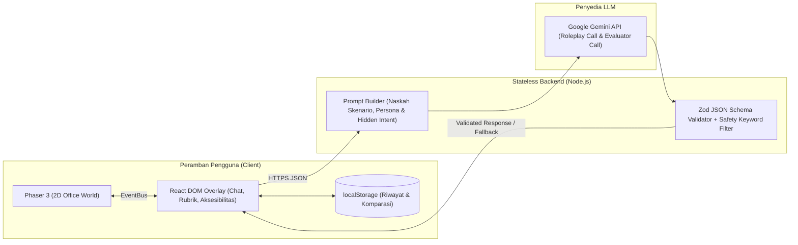

# 🧠 NEUROSIM: Simulator Dinamika Kantor Berbasis Agen AI untuk Pekerja Neurodivergen

> **Mengubah Tantangan Sosial Menjadi Kesiapan Profesional Melalui Simulasi Ruang Kerja Berbasis AI yang Aman, Adaptif, dan Terukur.**

[](https://github.com/)
[](https://github.com/)
[](https://github.com/)

Disusun oleh Tim **"mamah doain aku lolos final"** — Universitas Pembangunan Nasional "Veteran" Jawa Timur:
- **Rifat Abhista** - Lead Backend & AI Architecture
- **Priyoga Listyo Ananda** - 2D Game World & Phaser Engine
- **Baginda Putra Krista** - Frontend UI/UX, Aksesibilitas & Konten Skenario

---

## 📌 Daftar Isi
1. [Latar Belakang Masalah](#-latar-belakang-masalah)
2. [Solusi Kami: NEUROSIM](#-solusi-kami-neurosim)
3. [Fitur Utama (MVP)](#-fitur-utama-mvp)
4. [Tiga Skenario Inti & Rubrik 4 Dimensi](#-tiga-skenario-inti--rubrik-4-dimensi)
5. [Arsitektur Sistem & AI](#-arsitektur-sistem--ai)
6. [Keselamatan Psikologis & Aksesibilitas](#-keselamatan-psikologis--aksesibilitas)
7. [Panduan Instalasi & Menjalankan Proyek](#-panduan-instalasi--menjalankan-proyek)
8. [Deklarasi Penggunaan AI & Pihak Ketiga (AI & Third-Party Declaration)](#-deklarasi-penggunaan-ai--pihak-ketiga-ai--third-party-declaration)
9. [Lisensi & Referensi](#-lisensi--referensi)

---

## 🧩 Latar Belakang Masalah

Mahasiswa tingkat akhir dan lulusan baru (*fresh graduate*) neurodivergen—seperti individu pada spektrum autisme atau ADHD—sering kali memiliki kompetensi teknis yang kuat, namun tersandung pada **"kurikulum tersembunyi"** di dunia kerja: memahami komunikasi implisit sehari-hari.

Instruksi yang ambigu (*"Tolong dirapikan ya, besok pagi sudah harus bisa dilihat"*), kritik yang dibungkus basa-basi, hingga perubahan prioritas mendadak di luar jam kerja kerap memicu kecemasan dan kesalahpahaman ketika tidak tersedia ruang berlatih yang aman dan bebas penghakiman.

Berlandaskan **Teori *Double Empathy*** (Milton, 2012) serta semangat ketenagakerjaan inklusif di Indonesia (**UU No. 8 Tahun 2016 Pasal 53** & **PP No. 60 Tahun 2020**), **NEUROSIM tidak bertujuan "memperbaiki" atau menyeragamkan pengguna agar terdengar neurotipikal**. Sebaliknya, NEUROSIM menyediakan ruang simulasi privat agar pengguna dapat berlatih membaca konteks, mengajukan klarifikasi spesifik, dan menyampaikan batasan kerja secara jelas dengan gaya komunikasi mereka sendiri.

---

## 💡 Solusi Kami: NEUROSIM

**NEUROSIM** adalah simulator komunikasi kerja berbasis web yang menggabungkan eksplorasi ruang kantor 2D interaktif dengan simulasi percakapan berbasis *Large Language Model* (Google Gemini API) yang terstruktur.

### Alur Pengalaman Pengguna (4 Langkah, 1 Keputusan)
1. **Pilih Skenario & Tujuan:** Pengguna memilih skenario, menetapkan tujuan komunikasinya sendiri, mengatur tingkat kesulitan (Level 1–3), dan memilih visibilitas petunjuk (*hints*). Tersedia dalam **Dual-Mode UX**: *Mode Jelajah Kantor 2D* atau *Mode Daftar Skenario Langsung* (bebas distraksi visual).
2. **Baca Konteks Eksplisit:** Layar pengantar menjelaskan siapa lawan bicara, hubungan kerja, dan situasi yang sedang terjadi sehingga pengguna tidak perlu menebak latar.
3. **Berinteraksi (Maksimal 6 Giliran):** Percakapan berbasis teks dengan karakter AI. Selama sesi berlangsung, tombol kendali darurat (**Jeda, Lewati, Keluar, dan Petunjuk**) selalu tersedia.
4. **Terima Umpan Balik Berbasis Alasan:** Sistem menilai transkrip menggunakan rubrik 4 dimensi, membongkar **maksud tersembunyi (*hidden intent*)** lawan bicara, serta memberikan 2 contoh alternatif respons (versi ringkas dan versi rinci).
5. **Keputusan — Coba Lagi & Bandingkan:** Pengguna dapat mengulang skenario dengan pendekatan berbeda dan melihat perbandingan hasil antarpercobaan secara berdampingan (*side-by-side comparison*).

---

## ✨ Fitur Utama (MVP)

- **🎮 Hybrid Gather-like 2D & Direct Mode (Dual-Mode UX):** Eksplorasi ruang kantor 2D menggunakan **Phaser 3** yang dipadukan dengan lapisan antarmuka **React DOM Overlay** untuk menjamin keterbacaan teks, aksesibilitas pembaca layar, dan opsi beralih ke tampilan daftar langsung kapan saja.
- **🤖 Dual Isolated LLM Calls (Tanpa *Over-engineering*):** Satu model bahasa besar (**Google Gemini API**) yang dipisahkan secara tegas menjadi dua pemanggilan:
  1. *Persona Roleplay Call* (memerankan lawan bicara sesuai tingkat kesulitan dan batas perilaku).
  2. *Rubric Evaluator Call* (mengevaluasi transkrip secara objektif dengan keluaran skema JSON tervalidasi).
- **🎚️ Penyesuaian Kesulitan Berbasis Aturan (*Rule-Based Adaptive Difficulty*):**
  - **Level 1:** Instruksi lebih eksplisit, petunjuk aktif.
  - **Level 2:** Instruksi cukup implisit, rincian baru keluar bila ditanya.
  - **Level 3:** Instruksi implisit disertai perubahan/permintaan tambahan mendadak di tengah percakapan.
  - *Rekomendasi Otomatis:* Jika $\ge 3$ dimensi bernilai `Efektif`, sistem menawarkan naik level. Jika $\ge 2$ dimensi bernilai `Perlu Dilatih`, sistem menawarkan turun level atau mengaktifkan petunjuk.
- **🔒 Stateless Backend & Penyimpanan Lokal (`localStorage`):** Tidak ada basis data di server. Seluruh riwayat percobaan dan perbandingan hasil disimpan di peramban pengguna untuk melindungi privasi sepenuhnya.

---

## 📋 Tiga Skenario Inti & Rubrik 4 Dimensi

### Skenario pada MVP
| ID | Skenario | Karakter AI | Situasi | Keterampilan yang Dilatih |
| :--- | :--- | :--- | :--- | :--- |
| **1** | **Instruksi Ambigu** | **Bu Rina** *(Atasan Perfeksionis)* | Meminta halaman beranda "dirapikan" tanpa rincian dengan tenggat besok pagi. | Mengajukan pertanyaan klarifikasi yang singkat dan spesifik (objek kerja & batas waktu). |
| **2** | **Kritik Tidak Langsung** | **Dimas** *(Rekan Kerja Senior)* | Menanggapi hasil kerja dengan kalimat samar: *"Menarik sih, tapi mungkin bisa dipikirkan lagi."* | Menanyakan maksud sebenarnya dan meminta contoh perbaikan yang konkret. |
| **3** | **Revisi Mendadak** | **Pak Hendra** *(Klien)* | Meminta perubahan besar di luar jam kerja dengan tenggat mendesak. | Menetapkan batasan (*boundaries*), menegosiasikan tenggat, dan mengenali kapan melibatkan atasan. |

### Rubrik Penilaian 4 Dimensi
NEUROSIM menilai efektivitas komunikasi berdasarkan tujuan pengguna, **bukan** berdasarkan keramahan semu atau basa-basi sosial. Setiap dimensi dinilai dalam 3 tingkat deskriptif (**Perlu Dilatih**, **Berkembang**, **Efektif**):

1. **Kejelasan Pesan:** Apakah maksud pengguna mudah dipahami dan spesifik?
2. **Pemahaman Konteks:** Apakah pengguna menangkap apa yang sebenarnya diminta (termasuk yang tersirat) atau memastikannya lewat pertanyaan?
3. **Ketercapaian Tujuan:** Apakah respons mendekatkan pengguna ke tujuan latihan yang ia pilih sendiri di awal?
4. **Rasa Hormat & Batasan:** Apakah respons menghormati lawan bicara sekaligus menjaga kapasitas serta batasan kerja pengguna?

---

## 🏗️ Arsitektur Sistem & AI



### Penanganan Risiko Kesalahan AI (*Guardrails & Fallbacks*)
- **Jangkar Maksud Tersembunyi (*Human-Authored Hidden Intent*):** Maksud tersembunyi karakter ditulis oleh tim di sisi server, bukan dikarang oleh AI, sehingga evaluator memiliki tolok ukur yang konsisten.
- **Validasi Skema JSON & *Auto-Retry*:** Keluaran evaluator divalidasi dengan skema JSON ketat (`zod`). Jika format gagal, backend otomatis mengulang permintaan 1 kali; jika tetap gagal, sistem menampilkan umpan balik cadangan berbasis templat.
- **Batas Perilaku & Filter Keamanan:** Karakter AI dibatasi maksimal 6 giliran percakapan, diinstruksikan untuk tidak menyerang pribadi pengguna, dan keluarannya melewati filter kata kunci pada backend.

---

## 🛡️ Keselamatan Psikologis & Aksesibilitas

- **Bukan Alat Diagnosis:** NEUROSIM menyertakan pernyataan eksplisit bahwa aplikasi ini adalah alat latihan komunikasi kerja, bukan perangkat diagnosis medis maupun terapi klinis.
- **Transparansi & Fitur *Flagging* AI:** Setiap hasil evaluasi disertai catatan bahwa penilaian AI adalah satu sudut pandang dan dapat keliru. Pengguna dapat menekan tombol **"Tandai Umpan Balik Kurang Tepat"** jika merasa evaluasi tidak sesuai konteks.
- **Desain Ramah Sensorik:**
  - Pengaturan **Kurangi Gerak (*Reduce Motion*)** yang menonaktifkan animasi transisi dan *typewriter effect* agar nyaman bagi pengguna dengan sensitivitas visual maupun pengguna pembaca layar (*screen reader*).
  - Pengaturan **Ukuran Teks Dinamis** dan kontras warna tenang (standar WCAG AA).
  - Penanganan khusus input keyboard (`disableGlobalCapture` pada Phaser saat modal obrolan aktif) agar navigasi keyboard dan pengetikan di kolom chat berjalan mulus tanpa bentrok dengan kontrol game.

---

## 🚀 Panduan Instalasi & Menjalankan Proyek

### Prasyarat
- **Node.js** v18+ dan **npm**
- Kunci API **Google Gemini** (`GEMINI_API_KEY`)

### 1. Kloning Repositori
```bash
git clone https://github.com/username/neurosim.git
cd neurosim
```

### 2. Konfigurasi Variabel Lingkungan (*Environment Variables*)
Salin berkas `.env.example` menjadi `.env` pada direktori proyek/server, lalu masukkan kunci API Gemini Anda:
```env
GEMINI_API_KEY=masukkan_api_key_gemini_anda_di_sini
PORT=3001
```

### 3. Instalasi Dependensi & Menjalankan Aplikasi
```bash
# Instal seluruh dependensi
npm install

# Jalankan mode pengembangan (Frontend + Stateless Backend)
npm run dev
```
Buka peramban dan akses `http://localhost:5173`.

---

## 📜 Deklarasi Penggunaan AI & Pihak Ketiga (*AI & Third-Party Declaration*)

Sesuai dengan ketentuan *Hackathon INCEPTION 2026*, kami mendeklarasikan secara transparan seluruh layanan kecerdasan buatan (AI), pustaka, dan aset pihak ketiga yang digunakan dalam pengembangan **NEUROSIM**:

### 1. Layanan AI saat Aplikasi Berjalan (*Runtime AI Services*)
- **Google Gemini API (`@google/genai`):** Digunakan sebagai mesin pemrosesan bahasa alami untuk dua fungsi terpisah: (1) menghasilkan respons dialog karakter dalam skenario kerja, dan (2) mengevaluasi transkrip percakapan pengguna berdasarkan rubrik 4 dimensi.
- **Privasi Data Pengguna:** Backend NEUROSIM bersifat *stateless* dan tidak menyimpan transkrip percakapan di basis data server mana pun. Teks percakapan dikirimkan ke Google Gemini API semata-mata untuk pemrosesan sesi berjalan, dan pengguna diberi peringatan sebelum memulai simulasi agar tidak memasukkan informasi identitas pribadi (*PII*).

### 2. Alat Bantu AI selama Pengembangan (*Development-Time AI Assistance*)
- Selama *24-Hour Hacking Day*, tim menggunakan asisten AI (Google Gemini / LLM) sebagai pendamping penyusunan struktur kode, pembuatan skema validasi TypeScript/Zod, dan dokumentasi, dengan seluruh logika produk, skenario kerja, rubrik evaluasi, serta pengujian integrasi dikendalikan dan diverifikasi sepenuhnya oleh tim.

### 3. Pustaka Perangkat Lunak & Aset Visual Pihak Ketiga
- **Kerangka Kerja & Pustaka:** React, TypeScript, Vite, Phaser 3 (`v3.85+`), Tailwind CSS, Node.js, Zod, Lucide Icons.
- **Aset Visual 2D & UI:**
  - *Modern Rooms & People Unified Pack* (untuk latar ruangan kantor 2D, perabot, dan *sprite* karakter).
  - *Kenney Pixel UI Pack* (CC0 1.0 Universal — untuk elemen antarmuka pendukung).

---

## 📚 Lisensi & Referensi

Proyek ini dikembangkan untuk **Hackathon INCEPTION 2026 (HIMATIFA UPN "Veteran" Jawa Timur)**.

**Referensi Ilmiah & Regulasi:**
1. **Undang-Undang Republik Indonesia Nomor 8 Tahun 2016** tentang Penyandang Disabilitas (Pasal 53 mengenai kuota ketenagakerjaan inklusif) & **Peraturan Pemerintah Nomor 60 Tahun 2020** tentang Unit Layanan Disabilitas Bidang Ketenagakerjaan.
2. **Milton, D. E. M. (2012).** *On the ontological status of autism: The 'double empathy problem'*. Disability & Society, 27(6), 883–887. https://doi.org/10.1080/09687599.2012.710008
3. **Smith, M. J., dkk. (2014).** *Virtual reality job interview training in adults with autism spectrum disorder*. Journal of Autism and Developmental Disorders, 44(10), 2450–2463. https://doi.org/10.1007/s10803-014-2113-y